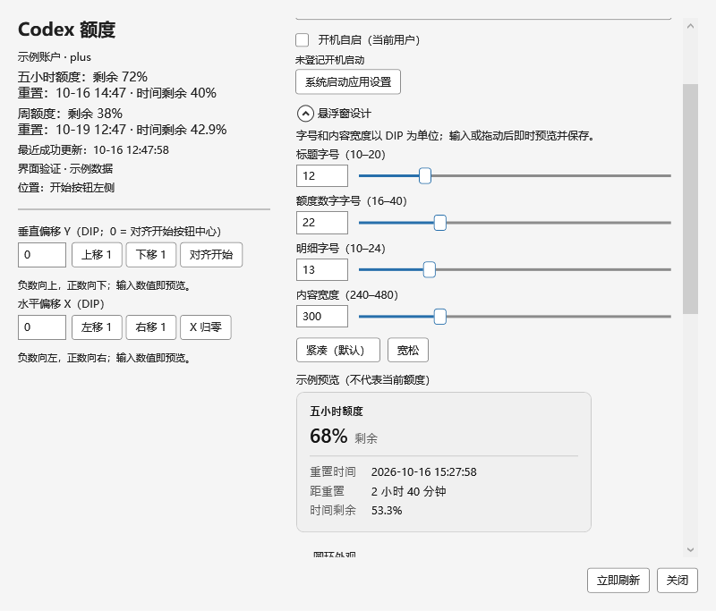

# CodexQuota

Windows 11 任务栏上的 Codex 额度圆环。随时查看五小时和周额度，以及距离重置还有多久。

使用 C#、WPF 和 Win32，面向 Windows x64，运行于 .NET Framework 4.8，无第三方 NuGet 包。本项目是独立工具，与 OpenAI 无隶属关系。

## 功能

- 两个空心圆环显示五小时、周额度剩余；可隐藏五小时圆环。
- 内侧或外侧时间细环，表示距离服务端重置时刻的时间比例。
- 自定义大小、间距、颜色、透明轨道、中心标签或百分比，以及 X/Y 偏移。
- 悬停查看重置日期与倒计时，按任务栏边缘向屏幕内侧弹出。
- 深浅主题跟随系统；独立调整悬浮窗字号和宽度，并即时预览。
- UI 定位与额度查询分开调度，支持自适应查询和当前用户开机自启。



图片使用明确标注的示例数据，不代表真实账户额度。[深色示例](docs/images/settings-dark.png)。

## 下载与运行

仓库发布后，在页面右侧 **Releases** 下载 `CodexQuota-v版本号-win-x64.zip`，解压并双击 `CodexQuota.exe`。发行版不要求安装 Visual Studio、Git 或 .NET SDK。首次上传前可能还没有 Releases；此时可按下方步骤自行编译。

先安装并登录官方 [Codex CLI](https://github.com/openai/codex)。本软件复用本机 CLI 的 ChatGPT 登录状态；无法自动找到时，在设置中选择官方 `codex.exe`。API Key 账户的计费不等同于 ChatGPT 订阅额度。

点击圆环打开设置，悬停查看详情，右键刷新或退出；托盘中也有菜单入口。弧长表示**剩余额度**，中心百分比在小圆环内省略 `%`。粗环表示额度，细环表示重置时间；未知数据显示问号，失败时保留上次成功数据并标记过期。

可选安装到当前用户的程序目录，在解压目录打开 PowerShell：

```powershell
powershell.exe -NoProfile -ExecutionPolicy Bypass -File .\Install.ps1 -Launch
```

默认目录为 `%LOCALAPPDATA%\Programs\CodexQuota`，无需管理员权限。便携使用也会将设置保存在 `%LOCALAPPDATA%\CodexQuota\settings.json`。升级与卸载见[安装指南](docs/INSTALLATION.md)。目前发行文件未做代码签名；SHA256 清单用于核对文件，不替代签名。

## 从源码编译

下载或克隆仓库，进入包含 `Build.ps1` 的目录：

```powershell
powershell.exe -NoProfile -ExecutionPolicy Bypass -File .\Build.ps1 -RunTests
.\Release\CodexQuota.exe
```

脚本使用 Windows 的 Framework64 C# 编译器和系统 WPF 程序集，无需额外 SDK。前置条件和打包命令见[编译指南](docs/BUILDING.md)。自动测试使用模拟协议与测试窗口，无需真实 Codex 登录。[验证范围](VALIDATION.md)区分了自动检查与仍需实机验收的场景。

## 数据与兼容性

通过官方 `codex app-server` 的 `account/read` 和 `account/rateLimits/read` 获取数据，不直接读取认证文件，不发起模型对话，不按本地计时猜测额度恢复。软件自身没有遥测上传；官方 CLI 的联网与认证行为由官方客户端处理。详见[架构说明](docs/ARCHITECTURE.md)。

目前支持单账户、主屏、Windows x64，仅映射 300 分钟和 10080 分钟额度窗口。任务栏附着使用 Win32 原生子窗口，不是 Windows 官方插件槽位；系统更新或第三方任务栏软件可能影响兼容性，可切换独立悬浮或仅托盘。未提供自动更新、多账户和历史曲线。

## 文档与参与

- [安装、升级与故障排查](docs/INSTALLATION.md)
- [编译与打包](docs/BUILDING.md)
- [GitHub 上传与发行](docs/RELEASING.md)
- [更新日志](CHANGELOG.md)
- [贡献说明](CONTRIBUTING.md)

## 支持项目

如果 CodexQuota 对你有帮助，欢迎通过支付宝自愿赞助，支持后续维护与功能改进。赞助与软件使用、功能及许可证授权无关。


[查看赞助码原图](docs/images/sponsor-alipay.jpg)

## 许可证与致谢

Copyright (C) 2026 CodexQuota contributors.

本项目依据 **GNU General Public License v3.0，仅第 3 版**（`GPL-3.0-only`）授权，完整条款见 [LICENSE](LICENSE)。允许使用、修改及商业用途；分发本项目或修改版时，应遵守 GPLv3 的对应源码提供、版权声明和许可证保留等要求。软件不提供任何担保，具体以许可证条款为准。

任务栏附着思路参考 [TrafficMonitor](https://github.com/zhongyang219/TrafficMonitor)，本项目独立实现，未复制其源码。图标为生成的双圆弧图案，来源见 [assets/README.md](assets/README.md)。Codex 名称及相关商标归各自权利人所有。
